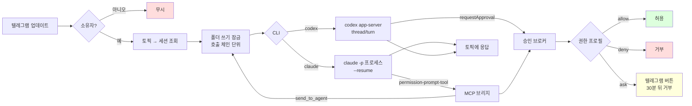

# 아키텍처 — MVP 1단계 (코어 엔진)

결정 `decisions/0001`~`0014`를 코드 구조로 옮긴 문서다. **1단계 범위**는 코어 엔진(에이전트 로더, 저장소, 권한, 잠금, CLI 어댑터 2종, MCP 브리지, 텔레그램 게이트웨이, 오케스트레이터 도구)이다. 웹 UI(0012·0013), launchd/systemd 설치(0003), 로그인 점검 화면(0014)은 2단계로 미룬다.

아래 "공개 계약"은 `tests/acceptance/`의 고정 인수 테스트가 직접 호출한다. 계약을 바꾸려면 인수 테스트도 함께 바꿔야 하므로 사람의 결정이 필요하다.

## 저장소 구조

```
package.json              pnpm workspace 루트 (scripts: build, test, test:acceptance, lint)
pnpm-workspace.yaml
packages/server/          @remote-agent/server — 코어 엔진 (TypeScript, ESM, Node 22)
  src/index.ts            공개 계약 export
  src/mcp-bridge.ts       MCP 브리지 진입점. `node --experimental-strip-types`로 직접 실행할 수 있어야 한다
                          (상대 import는 `.ts` 확장자, enum·namespace 등 타입 제거만으로 안 되는 문법 금지)
tests/acceptance/         고정 인수 테스트 (vitest) + fakes/
```

루트 `package.json`에는 아직 `@remote-agent/server: workspace:*`를 넣지 않는다(패키지가 없으면 `pnpm install`이 실패한다). 인수 테스트는 vitest alias로 `packages/server/src/index.ts`를 직접 가져온다.

## 처리 흐름

텔레그램 메시지가 들어오면 소유자인지 확인하고, 토픽에 연결된 세션을 찾고, 폴더 잠금을 잡은 뒤 CLI 어댑터로 한 턴을 실행해 결과를 같은 토픽으로 돌려보낸다. 실행 중 도구 승인 요청은 MCP 브리지(Claude) 또는 app-server 요청(Codex)을 통해 승인 브로커로 들어가고, 권한 프로필이 `ask`로 판단한 것만 텔레그램 버튼으로 묻는다.



## 공개 계약 (`@remote-agent/server`)

### 에이전트 정의 (0006)
`<작업 폴더>/.remote-agent/agents/<name>.md`. YAML frontmatter와 본문(역할 프롬프트)으로 이루어진다.

```md
---
cli: claude            # claude | codex
model: sonnet          # 선택
profile: standard      # readonly | standard | trusted (기본 standard)
allow: ["npm test", "git status"]   # 선택. 승인 없이 허용할 셸 명령 접두사
orchestrator: false    # 선택. true면 list_agents / send_to_agent 도구를 받는다
---
역할 프롬프트 본문
```

- `loadAgents(folder: string): Promise<AgentDefinition[]>` — 이름순 정렬. `AgentDefinition = { name, folder, cli, model?, profile, allow: string[], orchestrator: boolean, prompt }`. 파일이 없으면 `[]`, 잘못된 `cli`·`profile`은 `Error`(메시지에 파일명 포함).

### 저장소
- `openStore(file: string): Store` (`':memory:'` 허용). SQLite. 최소 기능: `bindTopic({chatId, threadId, folder, agent})`, `findBinding(chatId, threadId)`, `setSessionId(chatId, threadId, cliSessionId)`, `appendEvent(...)`, `close()`.

### 권한 (0009)
- `decidePermission(agent, request) → 'allow' | 'ask' | 'deny'`
  - `request = { kind: 'read' | 'edit' | 'shell' | 'network', path?: string, command?: string }`. `path`는 절대 경로다.
  - `readonly`: read는 작업 폴더 안이거나 경로가 없으면 allow, 폴더 밖이면 deny. 나머지 → deny (`allow` 목록이 있어도 shell은 deny)
  - `standard`: read는 작업 폴더 안이거나 경로가 없으면 allow, 폴더 밖이면 ask(0009의 "작업 폴더 밖 접근은 승인"). edit는 작업 폴더 **안**이면 allow, 밖이면 ask. shell은 `allow` 접두사와 일치하면 allow, 아니면 ask. network → ask
  - `trusted`: 전부 allow
  - "안"의 판정: `path`를 정규화(`..` 처리)한 뒤 `folder`와 같거나 `folder + '/'`로 시작해야 한다. `/work/shop-evil`은 `/work/shop` 밖이다.
  - 접두사 일치는 단어 경계 기준이다: 명령이 접두사와 같거나 `접두사 + 공백`으로 시작해야 한다(`npm testx`는 `npm test`와 불일치).
  - 셸 제어 문자(`;` `&` `|` `` ` `` `$(` `>` `<` 줄바꿈)가 들어간 명령은 `allow` 목록과 관계없이 ask다(`npm test && rm -rf /` 방지).
- `createApprovalBroker({ timeoutMs = 30*60*1000 })`
  - `request(info) → Promise<'allow' | 'allow_session' | 'deny'>`. `info = { sessionId: string, kind, command?, path?, ...그 밖의 표시용 필드 }`. `timeoutMs`가 지나면 `'deny'`.
  - `respond(id, decision)`, `pending()` 목록, `on('request', cb)` 이벤트. 이벤트와 `pending()` 항목은 `{ id, ...info }`이다. `id`는 `:`를 넣지 않은 40자 이하 문자열이다(`callback_data` 64바이트 제한).
  - `allow_session`을 받으면 같은 세션의 같은 종류(shell은 같은 명령 첫 단어, 그 밖에는 같은 kind) 요청은 이후 이벤트 없이 바로 `'allow'`(또는 `'allow_session'`)로 풀린다.

### 쓰기 잠금 (0010, 0011)
- `createLockManager()` → `acquire(folder, chainId) → Promise<release()>`
  - 같은 `folder`에서 **다른** `chainId`는 FIFO로 기다린다.
  - **같은** `chainId`는 재진입한다. 바로 획득하고, 해제는 참조 카운트로 처리한다.
  - `readonly` 에이전트의 턴은 잠금을 잡지 않는다(호출하는 쪽 책임).

### CLI 어댑터 (0008, 0014)
공통 인터페이스 `CliAdapter.runTurn({ agent, prompt, sessionId?, chainId, onEvent }) → Promise<{ sessionId, text }>`, `close() → Promise<void>`(띄운 자식 프로세스를 모두 끝낸다).
자식 프로세스는 부모 환경을 상속한다(아래 제거 대상만 뺀다).
`onEvent(e)`: `{type:'text', text}` · `{type:'tool', name}` · `{type:'done'}` · `{type:'error', message}`.

- `createClaudeAdapter({ bin = 'claude', mcp: { command, args, env } })`
  - 실행: `<bin> -p <prompt> --output-format stream-json --verbose --permission-prompt-tool mcp__remote_agent__approve --mcp-config <임시 JSON 파일>`. 프롬프트는 `-p` 바로 다음 인자다. `sessionId`가 있으면 `--resume <id>`, 모델이 있으면 `--model <m>`, 역할 프롬프트는 `--append-system-prompt`, `cwd`는 작업 폴더.
  - `--mcp-config` 파일: `{"mcpServers":{"remote_agent":{"command","args","env"}}}`. `env`는 `mcp.env`에 `REMOTE_AGENT_CHAIN_ID=<chainId>`를 더한 것이다(앱은 에이전트 식별용 변수를 더 넣을 수 있다).
  - **금지**: `--bare`, `--dangerously-skip-permissions`. 자식 환경에서 `ANTHROPIC_API_KEY`·`ANTHROPIC_AUTH_TOKEN`을 제거한다.
  - stream-json: `system/init` → `assistant`(content[].text) … → `result`(`session_id`, `result`).
- `createCodexAdapter({ bin = 'codex' })`
  - 폴더마다 `<bin> app-server` 프로세스 하나를 상주시킨다(stdio, 줄 단위 JSON-RPC). `initialize` → `thread/start {cwd, approvalPolicy:'untrusted', sandbox}`(또는 `thread/resume {threadId}`) → `turn/start {threadId, input:[{type:'text', text}]}`.
  - 알림: `item/agentMessage/delta {delta}`, `turn/completed`.
  - 서버 요청 `item/commandExecution/requestApproval {command, cwd}`·`item/fileChange/requestApproval`은 승인 브로커를 거쳐 `{decision: 'accept' | 'acceptForSession' | 'decline'}`로 답한다.
  - sandbox: readonly → `read-only`, standard → `workspace-write`, trusted → `danger-full-access`.
  - 반환하는 `sessionId`는 threadId다. 같은 프로세스가 이미 아는 thread면 바로 `turn/start`, 모르는 thread(프로세스 재시작 뒤)면 먼저 `thread/resume`.
  - 승인 요청을 브로커로 잇는 방식은 앱 내부 구현이다. 인수 테스트는 앱 수준(e2e)에서만 검사한다.

### MCP 브리지 (0008, 0011)
`packages/server/dist/mcp-bridge.js`. Claude가 `--mcp-config`로 stdio 서버로 띄우는 프로세스다. 환경변수 `REMOTE_AGENT_BRIDGE_URL`(앱 내부 HTTP, 127.0.0.1)과 `REMOTE_AGENT_CHAIN_ID`로 앱에 중계한다.
- 도구 `approve({tool_name, input})` → 텍스트 JSON `{"behavior":"allow","updatedInput":input}` 또는 `{"behavior":"deny","message":…}`
- 오케스트레이터 에이전트에만: `list_agents()` → 같은 폴더의 에이전트 이름·cli·profile, `send_to_agent({name, message})` → 하위 에이전트의 턴 결과 텍스트(동기, 같은 `chainId`). 오케스트레이터가 아닌 에이전트가 부르면 도구 오류(JSON-RPC error 또는 `isError: true`)를 돌려주고 아무것도 실행하지 않는다.
- Claude 도구 → 권한 요청 종류: `Bash` → shell(`input.command`), `Edit`·`Write`·`MultiEdit`·`NotebookEdit` → edit(`input.file_path`), `Read`·`Grep`·`Glob`·`LS` → read, `WebFetch`·`WebSearch` → network. 모르는 도구는 ask로 다룬다.

### 앱 (텔레그램 게이트웨이, 0001·0007)
`createApp(config) → { start(), stop(), bridgeUrl }`

```ts
config = {
  dataDir: string,
  telegram: { token, apiBase = 'https://api.telegram.org', ownerId: number, groupChatId: number, defaultAgent?: { folder, name } },
  folders: string[],
  cli: { claudeBin?, codexBin? },
  approvalTimeoutMs?: number,
  mcpBridge?: { command: string, args: string[] },  // 브리지 실행 명령 재정의(기본: node packages/server/dist/mcp-bridge.js). 인수 테스트는 strip-types로 src를 띄운다
}
```

- `getUpdates` long polling만 쓴다(웹훅 없음). `timeout > 0`, 처리한 뒤에는 `offset = 마지막 update_id + 1`로 확인한다.
- 업데이트는 턴이 끝나기를 기다리지 않고 바로 다음 polling을 한다. 긴 턴 하나가 다른 토픽(특히 readonly 턴)과 승인 버튼 처리를 막지 않는다.
- 같은 폴더의 쓰기 턴(standard·trusted)은 잠금을 잡은 채 CLI 프로세스가 끝날 때까지 실행한다. readonly 턴은 잠금 없이 실행한다.
- `from.id !== ownerId`인 업데이트는 무시한다(응답하지 않음).
- 그룹에서 `/new <folder이름>/<agent>`를 받으면(`folder이름`은 `folders` 항목의 basename) `createForumTopic`으로 토픽을 만들고 바인딩한 뒤, 그 토픽에 안내 메시지를 보낸다.
- 바인딩된 토픽(`message_thread_id`)의 메시지는 그 세션으로 턴을 실행한다. 응답은 같은 `message_thread_id`로 `sendMessage`하고, 4096자 넘으면 나눠 보낸다.
- DM 메시지는 `defaultAgent`로 보낸다.
- 승인 세션(`allow_session`의 범위)은 토픽(바인딩) 하나다. 소유자가 아닌 사람의 `callback_query`는 무시한다.
- 승인이 `ask`이면 토픽에 인라인 키보드(`허용` / `세션 동안 허용` / `거부`, `callback_data = "ap:<id>:allow|session|deny"`)를 보내고, `callback_query`로 응답한다.

## Codex app-server 프로토콜 근거
2026-11-09 설치본 `codex-cli 0.167.0`에서 `codex app-server generate-json-schema`로 확인했다:
- ServerRequest `item/commandExecution/requestApproval`, `item/fileChange/requestApproval`. 결정값 `accept | acceptForSession | decline | cancel`
- ClientRequest `initialize`, `thread/start`, `thread/resume`, `turn/start`, `turn/interrupt`, `account/read`
- ServerNotification `thread/started`, `turn/started`, `turn/completed`, `item/agentMessage/delta`, `item/completed`
- `AskForApproval`: `untrusted | on-request | never`. `SandboxMode`: `read-only | workspace-write | danger-full-access`
